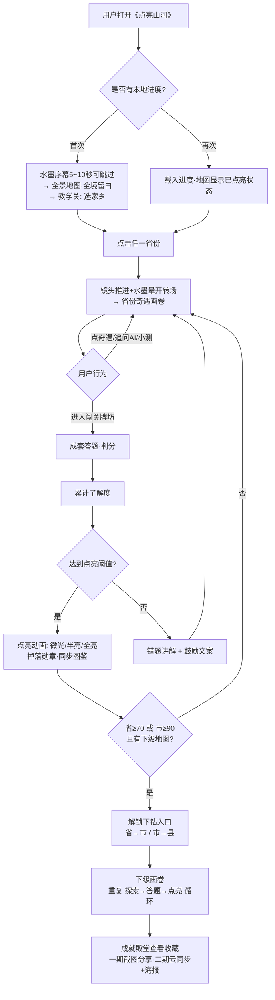
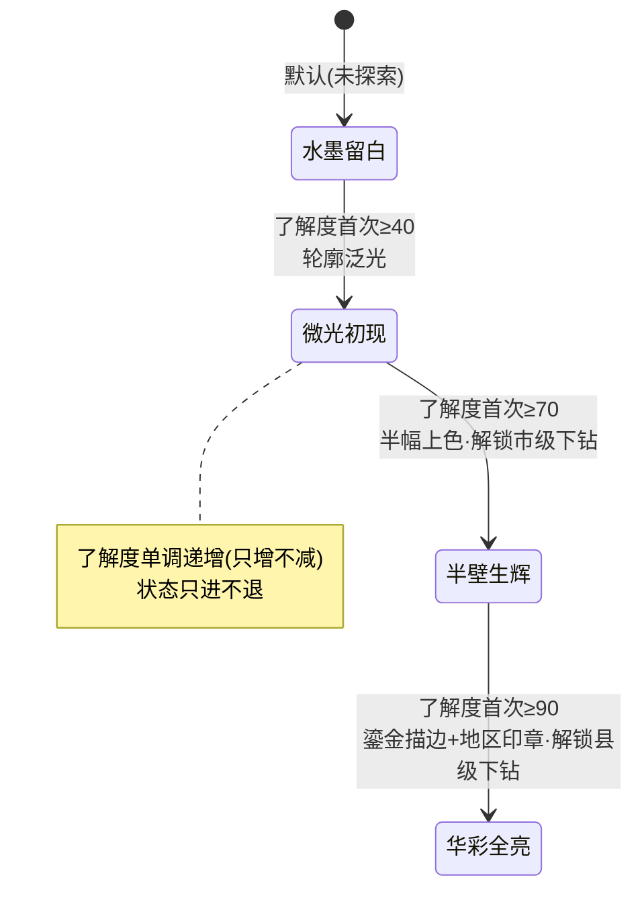
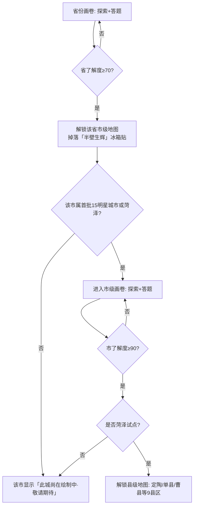

# 产品需求文档：《点亮山河》- 国风中国地理科普互动地图 - V1.0

| 项目 | 内容 |
|---|---|
| 文档版本 | PRD-001 / V1.0 |
| 日期 | 2026-10-23 |
| 产品名 | 点亮山河 |
| 平台 | Web（PC 优先，响应式兼容手机） |
| 账号 | 一期免登录（本地存储） |
| 状态 | 已与需求方逐项确认定稿 |

---

## 1. 综述 (Overview)

### 1.1 项目背景与核心问题

**背景痛点**：
1. 大众中国地理常识普遍薄弱且常被以讹传讹（如"山东属于东北"——实际东北指黑吉辽三省；"人参貂皮鹿茸"的东北三宝顺口溜被张冠李戴）。
2. 现有地理科普形态枯燥：百科类产品是"检索式"（用户必须先知道要查什么），教辅类是"考试式"，都缺少探索乐趣，无法让成年人主动沉迷。
3. 地方知识（历史典故、名人轶事、地方美食、网络热梗）散落各处，没有一个产品把它们与地理空间绑定成"可探索、可收集"的体验。

**产品定位**：一幅可以点亮的国风水墨中国地图。用户点击省份，镜头推进展开该省水墨画卷，在画卷中"撞见"散落的知识奇遇（名人、风物、典故、热梗），通过答题闯关逐步点亮该地区，层层下钻至市、县，收集冰箱贴式勋章与稀有度卡牌。

**核心理念**："知识以猝不及防的方式进入玩家的脑袋"——不让用户选知识（分类菜单式），而是把知识埋伏在画卷的奇遇点里，点开之前不知道是什么，点开即惊喜（盲盒式、开箱感）。

**双人群（不选身份，一套内容两种读法）**：
- **成年探索者**：游戏化探索 + 收集欲（冰箱贴/卡牌）+ 通晓古今的趣味内容（李清照与黄渤同卷、范蠡与"曹县宇宙中心"并存），可炫耀可分享。
- **学生**：打开"考点模式"后，同样的奇遇内容出现中高考考点角标、闯关题库混入真题风格题、画卷内出现考点巡礼清单，把课内知识点与地方趣味内容串联。

**体验参考基准**（用户明确指定）：
- 镜头语言参考《仙剑奇侠传》《梦幻西游》的地图切换、《黑神话：悟空》的场景推进：点击省份后镜头缓缓推进、水墨晕开转场（约 2~3 秒），是"走进去"，不是弹窗或跳页。
- 开场序幕参考《黑神话：悟空》：水墨长卷 + 开篇文案的仪式感开场，随后进入教学体验。

### 1.2 核心业务流程 / 用户旅程地图

1. **阶段一：初见山河** - 水墨序幕 → 全景中国地图（未探索=水墨留白）→ 教学关以"选家乡"开场，走完第一轮"进画卷→遇奇遇→答题→点亮"。
2. **阶段二：探索求知** - 点击省份镜头推进，在散点奇遇 + 每日随机高亮的画卷中撞见知识惊喜，可追问 AI、做小测、收行囊。
3. **阶段三：答题点亮** - 闯关牌坊成套答题 + 奇遇插题，了解度（探索分 40% + 答题分 60%）达到 40/70/90 触发微光初现/半壁生辉/华彩全亮三档点亮。
4. **阶段四：层层下钻** - 省半亮(≥70)解锁市级，市全亮(≥90)解锁县级（一期试点：菏泽全境），层层点亮。
5. **阶段五：收藏成就** - 双轨勋章（地区冰箱贴 + 奇遇卡牌 N/R/SR/SSR）进成就殿堂；进度本地保存。
6. **阶段六：传播分享** - 一期点亮动画可截图分享；二期微信登录云同步 + 朋友圈海报。

### 1.3 Mermaid 图

#### 1.3.1 用户操作流（已确认定稿）



#### 1.3.2 点亮档位状态机（每个省/市/县独立一套）



#### 1.3.3 层级下钻解锁流



---

## 2. 用户故事详述 (User Stories)

### 阶段一：初见山河

---

#### **US-01: 作为初次到访的用户，我希望被一幅水墨中国地图瞬间吸引并自然明白玩法，以便于我留下来开始探索**

*   **价值陈述 (Value Statement)**:
    *   **作为** 初次到访的用户（成年探索者或学生）
    *   **我希望** 打开网页即见水墨序幕与全景中国地图，并通过"选家乡"教学关快速上手
    *   **以便于** 我在 1 分钟内理解玩法并对家乡点亮产生情感投入

*   **业务规则与逻辑 (Business Logic)**:
    1.  **前置条件**: 无（首次访问）；再次访问时已有本地进度则跳过序幕与教学关，直接载入地图。
    2.  **操作流程 (Happy Path)**:
        1. 首次打开《点亮山河》，播放水墨序幕：长卷缓缓展开 + 开篇文案（示例："九百六十万平方公里，你点亮过几寸？"），时长 5~10 秒，任意点击可跳过。
        2. 序幕结束进入全景中国地图：所有省份呈**水墨留白**态（可见轮廓、无色彩），常驻元素就位：考点模式开关、成就殿堂入口、行囊、设置、点亮总进度（省/市/县计数）。
        3. 教学关触发：**"你的家乡是哪里？看看你对家乡了解多少"** → 用户点选家乡省份 → 镜头推进进入家乡画卷 → 引导依次完成：点开一个奇遇 → 做一道小测 → 进闯关牌坊答一题 → 观看点亮反馈。
        4. 教学关可**中途收起**（用户点击右上角收起按钮），顶部出现常驻"继续启程"入口，下次进入可从断点继续。
        5. 教学关完成后，家乡省份在全景地图上显示对应点亮档位。
        6. **镜头语言（全产品统一）**：点击省份 → 镜头缓缓推进 + 水墨晕开转场（约 2~3 秒）→ 展开省份画卷；返回时镜头拉远回全景。禁止使用生硬弹窗/跳页切换层级。
        7. **地图三态显示**：水墨留白（未探索）/ 微光初现（轮廓泛光）/ 半壁生辉（半幅上色）/ 华彩全亮（鎏金描边 + 地区印章徽记）。
        8. 悬停省份 → 浮现气泡：`[省名 · 当前档位 · 了解度%]`。
    3.  **异常处理 (Error Handling)**:
        *   地图底图资源加载失败/超时 → 显示水墨风格占位 + "山高路远，稍后再试" + 重试按钮，不白屏。
        *   用户跳过序幕/教学关 → 不再自动弹出，"继续启程"常驻顶部供随时回来。
        *   低性能设备 → 转场动画自动降级为快速淡入淡出。
    4.  **合规硬约束（优先级高于一切视觉设计）**: 地图必须基于自然资源部**标准地图服务**底图（正式上线需申请展示审图号，具体审图号以实际申请结果为准）；省级边界形状、九段线、南海诸岛等**不得变形、不得遗漏**；山水画风仅作为标准底图之上的"皮肤层"。

*   **验收标准 (Acceptance Criteria)**:
    *   **场景1: 首次进入**
        *   **GIVEN** 用户首次访问且网络正常 **WHEN** 打开页面 **THEN** 5 秒内出现水墨序幕，全程提供"跳过"入口。
    *   **场景2: 教学关选家乡**
        *   **GIVEN** 序幕结束 **WHEN** 全景地图出现 **THEN** 弹出"你的家乡是哪里？"教学引导，点选省份后镜头推进进入该省画卷。
    *   **场景3: 教学关中断续玩**
        *   **GIVEN** 教学关进行到答题环节 **WHEN** 用户点击收起 **THEN** 教学关收起、顶部出现"继续启程"，再次点击可从断点继续。
    *   **场景4: 地图加载失败**
        *   **GIVEN** 底图服务不可用 **WHEN** 加载超时 **THEN** 显示"山高路远，稍后再试"占位与重试按钮，不出现白屏或报错堆栈。
    *   **场景5: 地图合规**
        *   **GIVEN** 任意页面展示中国地图 **WHEN** 检查边界 **THEN** 与标准地图一致（含九段线、南海诸岛），页面标注审图号。

---
*   **页面布局线框图 (ASCII Wireframe)**:

```text
========================= 序幕态（首次，5~10秒，可跳过） =========================

                 ~ ~ ~ ~ ~ ~ ~  水 墨 长 卷 缓 缓 展 开  ~ ~ ~ ~ ~ ~ ~

                     「 九百六十万平方公里，你点亮过几寸？ 」

                                                            [跳过序幕]

==================================================================================

+================================================================================+
| [印章LOGO] 点亮山河          [考点模式(○关)] [成就殿堂] [行囊] [设置⚙]          |
+--------------------------------------------------------------------------------+
| [继续启程 ▼]  (教学关未完成时常驻，完成后消失)                                   |
|                                                                                |
|   +------------------------------------------------------------------------+  |
|   |                                                                        |  |
|   |            国 风 水 墨 · 中 国 地 图 （全景主视觉）                      |  |
|   |                                                                        |  |
|   |    · 未探索省  = 水墨留白（仅轮廓，无色彩）                              |  |
|   |    · 微光初现 = 轮廓泛光       · 半壁生辉 = 半幅上色                     |  |
|   |    · 华彩全亮 = 鎏金描边 + 地区印章徽记                                  |  |
|   |    · 悬停省份 → 气泡 [ 山东 · 留白 0% ]                                  |  |
|   |    · 点击省份 → 镜头推进 + 水墨晕开转场(2~3s) → 省份奇遇画卷              |  |
|   |                                                                        |  |
|   +------------------------------------------------------------------------+  |
|                                                                                |
|  点亮进度: 省 3/34 · 市 0/15 · 县 0/9         今日奇遇: [鲁●][桂●][湘○]       |
|  --------------------------------------------------------------                 |
|  页脚: 底图依据自然资源部标准地图服务 · 审图号: GS(20XX)XXXX[以实际申请为准]      |
+================================================================================+
```
---

### 阶段二：探索求知

---

#### **US-02: 作为进入省份画卷的用户，我希望在散落着奇遇点的水墨画卷里"撞见"知识惊喜，以便于我在探索中不知不觉记住这个地方**

*   **价值陈述 (Value Statement)**:
    *   **作为** 正在探索的用户
    *   **我希望** 点开画卷中的微光奇遇点之前不知道会遇到什么（名人/风物/山水/事件/热梗），并能在奇遇里继续追问、小测、收藏
    *   **以便于** 获得"开盲盒"式的知识惊喜，让知识以猝不及防的方式进入脑袋

*   **业务规则与逻辑 (Business Logic)**:
    1.  **前置条件**: US-01 完成（已点击省份进入画卷）；该省画卷种子内容已就绪。
    2.  **操作流程 (Happy Path)**:
        1. 进入省份画卷（如山东）：全省山水长卷徐徐展开（泰山、黄河、济南城、青岛湾等场景元素入画），**奇遇点以微光闪烁散布画卷各处**。
        2. **奇遇类型（点开前不可见类型，无分类菜单）**：名人（李清照、黄渤）、风物（单县羊汤）、山水（泰山）、历史事件（林则徐虎门销烟）、网络热梗（"曹县：宇宙的中心"）、地理考点（黄河入海口，考点模式下带角标）。
        3. **每日随机**：每次进入画卷，随机 3 个奇遇点高亮为"今日奇遇"（额外小奖励：了解度加成或彩蛋概率提升），制造"明天再来"的回流钩子。
        4. **交互四件套**（每个奇遇卡均具备）：
            *   **追问 AI**：奇遇卡底部"追问"输入框（示例预填："济南还出过哪些才女？"），AI 数秒内作答，答案必附来源。
            *   **奇遇小测**：读完奇遇内容后弹出 1 道单选题，答对额外累计了解度。
            *   **随机彩蛋**：点亮奇遇时有概率触发（双倍了解度 / 稀有卡牌掉落），开箱感强化。
            *   **收藏行囊**：重要奇遇可一键收入行囊，随时回看（行囊入口在顶栏）。
        5. **可信度三档标注**：史实（无标注）/ 民间传说（标注"民间传说"）/ 网络热梗（标注"网络热梗"）。AI 生成内容必附来源。
    3.  **异常处理 (Error Handling)**:
        *   AI 追问超时/失败 → 奇遇卡追问区显示"雾太浓，看不清，稍后再来"，种子奇遇内容与答题照常可用，不阻断主流程。
        *   画卷资源加载失败 → "山高路远，稍后再试" + 重试。
        *   奇遇小测答错 → 显示答案讲解（关联 1 个知识点），不扣已得了解度。
    4.  **依赖关系**: 依赖 US-08（AI 内容引擎）提供追问与长尾奇遇；依赖 US-03（了解度）承接小测计分。

*   **验收标准 (Acceptance Criteria)**:
    *   **场景1: 盲盒惊喜**
        *   **GIVEN** 用户在山东画卷中 **WHEN** 悬停/点击一个未点亮的奇遇点 **THEN** 点开前仅显示微光与"？"，不透露类型与内容。
    *   **场景2: 每日随机**
        *   **GIVEN** 同一用户两次在不同天进入山东画卷 **WHEN** 画卷加载完成 **THEN** 至少 1 个"今日奇遇"高亮点与上次不同，且高亮点总数为 3。
    *   **场景3: 追问 AI**
        *   **GIVEN** 已打开"李清照"奇遇卡 **WHEN** 输入"济南还有哪些名人？"并提交 **THEN** 数秒内（带墨迹晕开加载动效）显示带来源的回答。
    *   **场景4: AI 失败降级**
        *   **GIVEN** AI 服务不可用 **WHEN** 用户提交追问 **THEN** 显示"雾太浓，看不清，稍再来"，种子奇遇、小测、闯关全部照常可用。
    *   **场景5: 可信度标注**
        *   **GIVEN** 奇遇内容为民间传说（如范蠡传说） **WHEN** 奇遇卡展开 **THEN** 卡片带有"民间传说"标识；史实类无标识；热梗类带"网络热梗"标识。

---
*   **页面布局线框图 (ASCII Wireframe)**:

```text
+================================================================================+
| 中国 › 山东  [←返回·镜头拉远]      [考点模式(○)]  今日奇遇 1/3   [行囊] [殿堂]  |
+--------------------------------------------------------------------------------+
|                                                                                |
|  +--------------------------------------------------------------------------+ |
|  |                    山 东 · 水 墨 画 卷                                    | |
|  |                                                                          | |
|  |     ◈ 泰山          ◈ 黄河入海口            ◈ 李清照·济南                 | |
|  |   (微光闪烁)        (微光闪烁)              (微光闪烁)                    | |
|  |                                                                          | |
|  |        ◈ 单县羊汤       ◈ 曹县                ◈ 青岛啤酒                  | |
|  |                                                                          | |
|  |     ✦黄渤(今日奇遇·高亮)        🏛 闯关牌坊「岱宗问剑」                     | |
|  |                                                                          | |
|  |   · ◈ = 奇遇点微光；✦ = 今日奇遇高亮；点开前不显示内容类型                  | |
|  |   · 🏛 = 闯关牌坊（成套答题入口，见 US-04）                                 | |
|  +--------------------------------------------------------------------------+ |
|                                                                                |
|  山东 了解度 ████████░░░░░░░░ 42% ● 微光初现      [考点巡礼清单]（模式开时显示）|
+================================================================================+

        点开奇遇点后（右侧滑入奇遇卡）:
        +--------------------------------------------+
        | 🏮 李清照          [SR·卡牌]     [收进行囊] |
        |--------------------------------------------|
        |  「生当作人杰，死亦为鬼雄。」                |
        |  号易安居士，济南章丘人，宋代婉约词宗……      |
        |  （约120字精编内容）                        |
        |  📎 来源: ××百科 / ××地方志                 |
        |--------------------------------------------|
        |  小测: 李清照的号是？                       |
        |      (A) 易安居士 ✓  (B) 青莲  (C) 少陵    |
        |  答对 → 了解度+  ✨                        |
        |--------------------------------------------|
        |  追问: [ 济南还出过哪些才女？ ]             |
        |  (AI作答·附来源·墨迹晕开动效)               |
        +--------------------------------------------+
```
---

#### **US-07: 作为学生用户（或家长），我希望打开考点模式后把趣味内容与课内考点串联起来，以便于玩着就把中高考知识点复习了**

*   **价值陈述 (Value Statement)**:
    *   **作为** 学生用户
    *   **我希望** 一个开关就能让全产品的奇遇与题目带上考点属性
    *   **以便于** 探索乐趣不变的前提下，顺手完成考点复习与自查

*   **业务规则与逻辑 (Business Logic)**:
    1.  **前置条件**: US-01 完成；考点模式开关位于顶栏，全局生效，默认关闭。
    2.  **操作流程 (Happy Path)**:
        1. 用户点击顶栏"考点模式"开关 → 开关切到"开"，全产品立即生效（无需刷新）。
        2. **考点角标**：属于初高中地理/历史考点的奇遇卡显示"考点"角标（如山东的季风气候、黄河入海口、泰山断层山）。
        3. **真题题库**：闯关牌坊题库按比例混入中高考真题风格题，题目带真题角标（示例标注"真题风格·2023 济南中考"）。
        4. **考点巡礼清单**：画卷底部出现"考点巡礼"入口，展示该地区考点清单（如山东：温带季风气候/黄河下游/半岛海岸线），点击条目跳转到对应奇遇点，方便按知识点逐个扫荡。
        5. 关闭开关 → 立即回到纯探索模式，所有考点元素隐藏。
    3.  **异常处理 (Error Handling)**:
        *   某地区考点清单未配置 → 巡礼入口隐藏，不显示空列表。
    4.  **依赖关系**: 依赖 US-02（奇遇卡承载角标）、US-04（题库混题）；开关状态随 US-09 本地保存。

*   **验收标准 (Acceptance Criteria)**:
    *   **场景1: 开关生效**
        *   **GIVEN** 用户位于山东画卷 **WHEN** 打开考点模式开关 **THEN** 当前页面无需刷新即出现考点角标、巡礼入口。
    *   **场景2: 真题混入**
        *   **GIVEN** 考点模式开启 **WHEN** 用户进入闯关牌坊 **THEN** 每套题中至少 1 题带真题风格角标；关闭模式后该角标不再出现。
    *   **场景3: 巡礼跳转**
        *   **GIVEN** 考点模式开启 **WHEN** 用户在巡礼清单点击"黄河入海口" **THEN** 画卷镜头平移至对应奇遇点并高亮。
    *   **场景4: 状态保存**
        *   **GIVEN** 考点模式开启后关闭浏览器 **WHEN** 再次打开 **THEN** 开关保持开启状态。

---

### 阶段三：答题点亮

---

#### **US-03: 作为持续探索的用户，我希望每一次探索和答题都累计成看得见的点亮进度，以便于获得明确的成就感与继续玩的目标**

*   **价值陈述 (Value Statement)**:
    *   **作为** 持续探索的用户
    *   **我希望** 了解度以透明、公平、防刷的方式累计，并对应三档可见的点亮状态
    *   **以便于** 我的每一分投入都在地图上看得见

*   **业务规则与逻辑 (Business Logic)**:
    1.  **前置条件**: US-02 奇遇体系与 US-04 答题体系就绪；每个地区（省/市/县）独立计算了解度。
    2.  **计算公式（定稿）**:
        ```
        了解度(0~100) = 探索分 × 40% + 答题分 × 60%

        探索分 = 已点亮奇遇数 ÷ 该地区奇遇总数 × 100
        答题分 = 闯关题累计正确率 × 题库覆盖率（已作答题数 ÷ 题库总题数）
        ```
    3.  **防刷规则**:
        *   同一奇遇只计 1 次探索分（重复点开不重复计）。
        *   同一道题以**首次作答**计分，重复答对不刷分。
        *   每日奇遇的额外加成仅当日有效，且同一奇遇被选为"今日奇遇"已计过探索分的不再重复计探索分。
    4.  **单调递增原则**: 了解度只增不减（答错不扣分，已点亮档位永不回退）。
    5.  **三档点亮（状态机见 1.3.2）**:
        | 档位 | 阈值 | 视觉表现 | 附加效果 |
        |---|---|---|---|
        | 微光初现 | 了解度 ≥ 40 | 省份轮廓泛光 | — |
        | 半壁生辉 | 了解度 ≥ 70 | 半幅上色 | 解锁市级下钻（US-05）；掉落冰箱贴 |
        | 华彩全亮 | 了解度 ≥ 90 | 鎏金描边 + 地区印章徽记 | 解锁县级下钻（市全亮，仅试点）；掉落鎏金冰箱贴 + 成就 |
    6.  **升档时刻**: 播放点亮动画（水墨晕开 + 光效 + 音效），弹出勋章掉落卡（US-06），此为产品最强正反馈时刻。
    7.  **异常处理**: 了解度计算所需的奇遇总数因 AI 扩充而变化时，以"当前已就绪的奇遇总数"为分母，用户已得分不受损（比例重算不低于原值）。
    8.  **依赖关系**: 被 US-02（小测计分）、US-04（闯关计分）写入；被 US-05（下钻解锁）读取。

*   **验收标准 (Acceptance Criteria)**:
    *   **场景1: 首次升档**
        *   **GIVEN** 山东了解度当前 38 **WHEN** 用户答对一题使了解度达到 41 **THEN** 播放点亮动画，山东在全景地图呈"微光初现"态，进度条更新为 41%。
    *   **场景2: 防刷**
        *   **GIVEN** 用户已点亮"泰山"奇遇 **WHEN** 再次点开泰山奇遇 **THEN** 探索分不重复累计。
    *   **场景3: 首答计分**
        *   **GIVEN** 某题首次作答答错 **WHEN** 用户重复作答该题答对 **THEN** 该题不计入正确率提升（以首答为准）。
    *   **场景4: 只增不减**
        *   **GIVEN** 用户已达"半壁生辉" **WHEN** 后续闯关答错多题 **THEN** 档位不回退，了解度数值不下降。

---

#### **US-04: 作为想检验自己的用户，我希望通过场景化的闯关答题证明我对这个地方的了解，以便于解锁点亮与稀有奖励**

*   **价值陈述 (Value Statement)**:
    *   **作为** 探索中的用户
    *   **我希望** 答题被包装成画卷里的"闯关牌坊"和奇遇中的随机小测，而不是一张考试卷
    *   **以便于** 检验知识的过程本身也是游戏体验

*   **业务规则与逻辑 (Business Logic)**:
    1.  **前置条件**: 用户位于某地区画卷（省/市/县）内。
    2.  **操作流程 (Happy Path)**:
        1. **闯关牌坊**：每个地区画卷中有一座显眼的牌坊建筑（命名与地方绑定，如山东=「岱宗问剑」、菏泽=「牡丹问策」），点击进入成套答题。
        2. **成套规则**：每套 5 题，题型一期为单选题与判断题（看图识地作为彩蛋题型随机出现）；题目优先来自人工种子题库，AI 拓展题经缓存沉淀后混入。
        3. **答错处理**：立即显示讲解（答案依据 + 1 个关联知识点，如"杜甫《望岳》——五岳分别是？"），然后进入下一题；答错不扣分、不阻断。
        4. **结算反馈**：套题结束显示本关成绩（正确率）、了解度增量预告、掉落奖励（US-06）；未达点亮阈值时显示鼓励文案（示例："再遇几个奇遇，齐鲁大地便灯火可期"）。
        5. **奇遇插题**（与 US-02 联动）：浏览奇遇时的"奇遇小测"单题即时判分，即时累计了解度。
        6. **考点模式联动**（US-07）：开启后套题中混入真题风格题并带角标。
    3.  **异常处理 (Error Handling)**:
        *   题库加载失败 → "题目还在装裱，稍后再来"，可返回画卷继续探索。
        *   AI 出题超时 → 直接使用种子题库出题，用户无感知。
        *   答题中途退出 → 本次作答不保存（套题需完整完成才结算），已完成的套题成绩不受影响。
    4.  **依赖关系**: 依赖 US-03（计分）、US-08（AI 拓展题）、US-06（结算掉落）。

*   **验收标准 (Acceptance Criteria)**:
    *   **场景1: 完整闯关**
        *   **GIVEN** 用户点击山东「岱宗问剑」牌坊 **WHEN** 完成 5 题作答 **THEN** 显示正确率、了解度增量与掉落奖励。
    *   **场景2: 答错讲解**
        *   **GIVEN** 用户某题选择错误 **WHEN** 提交答案 **THEN** 显示答案讲解与关联知识点，随后可继续下一题。
    *   **场景3: 中途退出**
        *   **GIVEN** 套题进行到第 3 题 **WHEN** 用户点击返回画卷 **THEN** 本次套题不计成绩、不加了解度。
    *   **场景4: AI 出题降级**
        *   **GIVEN** AI 服务不可用 **WHEN** 用户进入闯关 **THEN** 全部使用种子题，流程正常完成。

---
*   **页面布局线框图 (ASCII Wireframe)**:

```text
+================================================================================+
| 中国 › 山东 › 🏛 岱宗问剑 · 闯关                              第 3 / 5 题     |
+--------------------------------------------------------------------------------+
|                                                                                |
|    【题目】「会当凌绝顶，一览众山小」描写的山东名山是？                          |
|                                                                                |
|    +--------------------------------------------------------------------+    |
|    |   (A) 崂山                                                         |    |
|    |   (B) 泰山    ← 选中态：墨色晕染高亮                                 |    |
|    |   (C) 蒙山                                                         |    |
|    |   (D) 沂山                                                         |    |
|    +--------------------------------------------------------------------+    |
|                                                                                |
|    本关进度 ●●●○○        [真题风格·2023中考]  ← 考点模式开时显示               |
|                                                                                |
|    答错时下方浮出讲解：                                                        |
|    +--------------------------------------------------------------------+    |
|    | 杜甫《望岳》。泰山为五岳之首…… 关联知识：五岳分别指哪些山？           |    |
|    +--------------------------------------------------------------------+    |
+================================================================================+
```
---

### 阶段四：层层下钻

---

#### **US-05: 作为点亮了省份的用户，我希望深入市、县画卷继续探索，以便于像挖宝一样层层深入到我家乡的县镇**

*   **价值陈述 (Value Statement)**:
    *   **作为** 已点亮省份的用户
    *   **我希望** 省半亮后进入市级画卷、市全亮后进入县级画卷，用同一套探索玩法逐层点亮
    *   **以便于** 从"山东"一路挖到"菏泽→定陶（范蠡）、单县（羊汤）、曹县（热梗）"

*   **业务规则与逻辑 (Business Logic)**:
    1.  **前置条件**: 上级地区达到解锁档位（见下）；目标下级地区在一期开放范围内。
    2.  **解锁与开放范围（定稿）**:
        | 层级 | 解锁条件 | 一期开放范围 |
        |---|---|---|
        | 省级（34 个） | 无（全开放） | 全国 34 省级全量 |
        | 市级 | 所属省了解度 ≥ 70（半亮） | 15 座明星城市：北京、上海、广州、深圳、成都、杭州、重庆、西安、南京、武汉、长沙、青岛、苏州、洛阳、哈尔滨 |
        | 县级 | 所属市了解度 ≥ 90（全亮） | 仅菏泽全境 9 县区试点（牡丹区、定陶区、曹县、单县、成武、巨野、郓城、鄄城、东明） |
    3.  **操作流程 (Happy Path)**:
        1. 省份达到半亮 → 全景地图该省出现下钻光效，点击省份 → 展开该省市级小地图（同一镜头推进语言）。
        2. 市级小地图中，一期开放的 15 城可点击进入；未开放城市显示"此城尚在绘制中，敬请期待"（保留轮廓，可查看城市名）。
        3. 进入市级画卷（与省级同构：奇遇点 + 牌坊 + 每日随机），市全亮后（仅菏泽）解锁县级。
        4. **层级导航**：面包屑常驻（`中国 / 山东 / 菏泽 / 定陶`），点击任意层级镜头拉远返回。
        5. **镇级处理**：一期不作为可点亮层级；镇级知识（如范蠡与定陶、庄子与东明）作为县级画卷中的奇遇内容出现。
    3.  **异常处理 (Error Handling)**:
        *   用户点击未开放城市 → 展示"此城尚在绘制中"水墨提示卡 + "去看看已开放的城"引导跳转。
        *   下钻入口在解锁档位边缘波动时（了解度单调递增故不会回退）无需处理降级。
    4.  **依赖关系**: 读取 US-03 档位；复用 US-02/US-04 玩法组件。

*   **验收标准 (Acceptance Criteria)**:
    *   **场景1: 省半亮解锁市级**
        *   **GIVEN** 山东了解度达到 70 **WHEN** 用户点击山东 **THEN** 镜头推进展开山东市级地图，15 座开放城市中山东省内的青岛可进入。
    *   **场景2: 未开放城市**
        *   **GIVEN** 用户在山东市级地图 **WHEN** 点击一期未开放的烟台 **THEN** 显示"此城尚在绘制中，敬请期待"，不可进入。
    *   **场景3: 市全亮解锁县级（菏泽试点）**
        *   **GIVEN** 菏泽市了解度 ≥ 90 **WHEN** 用户进入菏泽 **THEN** 解锁 9 县区地图，定陶、单县、曹县可进入探索。
    *   **场景4: 面包屑返回**
        *   **GIVEN** 用户位于 `中国/山东/菏泽/定陶` **WHEN** 点击面包屑"山东" **THEN** 镜头拉远回到山东省级画卷。

---

### 阶段五：收藏成就

---

#### **US-06: 作为收集型用户，我希望每点亮一处就获得精美勋章并在成就殿堂展示，以便于获得收集满足感与可炫耀的资本**

*   **价值陈述 (Value Statement)**:
    *   **作为** 收集型用户（旅游爱买冰箱贴的人群）
    *   **我希望** 双轨收集物（地区冰箱贴 + 稀有度卡牌）随着点亮不断掉落，且都能展示和回看
    *   **以便于** 像"电子冰箱贴墙"一样记录我去过（了解过）的地方，并有 SSR 式的炫耀时刻

*   **业务规则与逻辑 (Business Logic)**:
    1.  **前置条件**: US-03 点亮机制就绪。
    2.  **双轨收集物（定稿）**:
        *   **① 地区冰箱贴**：点亮即得。省级/市级/县级各档位独立掉落对应设计的冰箱贴（如"齐鲁大地·半壁生辉"款、"菏泽·华彩全亮鎏金"款），成套收集是长期目标。
        *   **② 奇遇卡牌（稀有度体系）**：点亮奇遇即掉落对应卡牌，稀有度按知识的历史分量分级：
            | 稀有度 | 定位 | 示例 |
            |---|---|---|
            | N（普通） | 日常风物 | 单县羊汤、方言冷知识 |
            | R（稀有） | 知名景点/名人 | 泰山、黄渤 |
            | SR（史诗） | 重大历史事件/文化宗师绑定 | 虎门·林则徐销烟、定陶·范蠡经商、济南·李清照 |
            | SSR（传说） | 顶流文化 IP"偶遇" | 画卷深处遇到李白 |
    3.  **掉落规则**: 点亮奇遇 → 掉对应卡牌（稀有度预置）；地区升档 → 掉冰箱贴；随机彩蛋（US-02）→ 概率掉落高稀有卡牌或双倍了解度。
    4.  **成就殿堂（三个 Tab）**:
        *   **勋章墙**：冰箱贴陈列（未获得位置显示 "?" 剪影，暗示收集目标）。
        *   **奇遇图鉴**：卡牌收集册（N/R/SR/SSR 分区计数）+ 行囊（收藏的重要奇遇可回看）。
        *   **成就列表**：如"初来乍到（完成教学关）""通晓齐鲁（山东全亮）""遇见诗仙（集齐李白足迹系列卡）"，显示进度条。
    5.  **炫耀时刻**：SSR 掉落时播放专属开卡动画（金光晕染 + 印章落下），并提供"保存截图"按钮（一期）。
    6.  **异常处理**: 勋章掉落写入失败（存储异常）→ 重试机制，确保"已点亮必有勋章"。
    7.  **依赖关系**: 依赖 US-03（升档触发）、US-02（奇遇掉落）、US-09（存储）。

*   **验收标准 (Acceptance Criteria)**:
    *   **场景1: 升档掉落冰箱贴**
        *   **GIVEN** 山东了解度达到 70 **WHEN** 点亮动画播放完毕 **THEN** 掉落"齐鲁大地·半壁生辉"冰箱贴并自动入勋章墙。
    *   **场景2: SSR 掉落**
        *   **GIVEN** 用户点亮一个 SSR 级奇遇（如"偶遇李白"） **WHEN** 掉落触发 **THEN** 播放专属开卡动画并提供保存截图按钮。
    *   **场景3: 图鉴计数**
        *   **GIVEN** 用户已收集 N 卡 23 张、SR 卡 2 张 **WHEN** 打开奇遇图鉴 **THEN** 显示对应分区计数与未解锁剪影位。
    *   **场景4: 掉落不丢失**
        *   **GIVEN** 存储写入瞬时失败 **WHEN** 重试成功 **THEN** 勋章与卡牌记录完整，无"点亮了但没勋章"状态。

---
*   **页面布局线框图 (ASCII Wireframe)**:

```text
+================================================================================+
| 成 都 殿 堂 · 收 藏                                            [返回地图]        |
+--------------------------------------------------------------------------------+
|  [勋章墙]   [奇遇图鉴]   [成就列表]              ← Tab 切换                     |
+--------------------------------------------------------------------------------+
|  ◆ 地区冰箱贴                                        已收集 3 / 58               |
|  +---------+ +---------+ +---------+ +---------+ +---------+ +---------+      |
|  | 齐鲁大地 | | 桂林山水 | | 金陵·半亮| |   ???   | |   ???   | |   ???   |      |
|  | 全亮鎏金 | |  微光款  | |         | | (未获得) | | (未获得) | | (未获得) |      |
|  +---------+ +---------+ +---------+ +---------+ +---------+ +---------+      |
|                                                                                |
|  ◆ 奇遇卡牌                                  N 23 / R 8 / SR 2 / SSR 0         |
|  +---------+ +---------+ +---------+ +---------+ +---------+ +---------+      |
|  | SSR ??? | | SR 林则徐| | SR 李清照| |  R 黄渤 | |  R 泰山  | | N 单县   |      |
|  | (未解锁) | | 虎门销烟 | |         | |         | |         | | 羊汤     |      |
|  +---------+ +---------+ +---------+ +---------+ +---------+ +---------+      |
|                                                                                |
|  ◆ 成就进度                                                                    |
|  ● 通晓齐鲁（山东全亮）        ████████░░ 62%                                   |
|  ● 遇见诗仙（集齐李白足迹卡）  ░░░░░░░░░░  0/7                                  |
|  ● 初来乍到（完成教学关）      ✓ 已达成                                         |
+================================================================================+
```
---

#### **US-09: 作为免登录用户，我希望点亮进度、勋章、行囊自动保存在本地，以便于下次打开接着玩**

*   **价值陈述 (Value Statement)**:
    *   **作为** 免登录用户
    *   **我希望** 所有进度（了解度/档位/勋章/卡牌/行囊/设置/教学关断点）自动保存且打开即恢复
    *   **以便于** 零门槛持续游玩

*   **业务规则与逻辑 (Business Logic)**:
    1.  **前置条件**: 浏览器本地存储可用。
    2.  **操作流程 (Happy Path)**:
        1. 关键动作**即时保存**：点亮奇遇、答题判分、升档、勋章/卡牌掉落、设置变更、教学关断点，每个动作完成后立即写入本地存储。
        2. 再次打开：载入全部进度，全景地图直接显示已点亮状态，跳过序幕与教学关。
        3. **风险告知**：首次完成教学关时与设置页内，以水墨风格提示："进度目前只保存在本机，清理浏览器缓存会丢失；云同步将在后续版本上线"（架构上预留同步接口，为 V2 做准备）。
    3.  **异常处理 (Error Handling)**:
        *   隐私模式/存储空间不足导致写入失败 → 顶部非阻断提示"进度可能无法保存，请检查浏览器设置"，游玩不中断。
        *   进度数据损坏（解析失败）→ 尝试备份副本恢复；仍失败则提示重置，教学关重新触发。
    4.  **依赖关系**: 被 US-03/US-06/US-07 写入；V2 云同步（不在本期）。

*   **验收标准 (Acceptance Criteria)**:
    *   **场景1: 即时保存**
        *   **GIVEN** 用户刚点亮一个奇遇 **WHEN** 立即关闭浏览器（不等任何延迟） **THEN** 重新打开后该奇遇仍为已点亮状态。
    *   **场景2: 断点恢复**
        *   **GIVEN** 教学关进行至答题环节且已中断 **WHEN** 用户再次打开 **THEN** 顶部"继续启程"存在且点击后从断点继续。
    *   **场景3: 写入失败提示**
        *   **GIVEN** 浏览器存储被禁用 **WHEN** 用户完成一次答题 **THEN** 出现"进度可能无法保存"提示，答题流程本身不受阻。

---

### 阶段六：传播分享 + 横切支撑

---

#### **US-08: 作为好奇心旺盛的用户，我希望在任意奇遇里都能追问到底（"山东还有哪些明星？""定陶为什么叫定陶？"），以便于知识从有限变无限**

*   **价值陈述 (Value Statement)**:
    *   **作为** 探索中的用户
    *   **我希望** 每个奇遇卡都能自然语言追问，系统接 AI 搜索（元宝 API）快速作答
    *   **以便于** 知识供给不局限于预写的 100 条，玩到哪里、问到哪里、学到哪里

*   **业务规则与逻辑 (Business Logic)**:
    1.  **前置条件**: 元宝搜索 API 已接入且可用（一期核心依赖，非可选）。
    2.  **内容供给架构（定稿：种子 + AI 双引擎）**:
        *   **种子内容（人工精编，质量底线与离线保底）**：每省 20~30 个精选奇遇 + 闯关题库 + 全部勋章/卡牌美术资源；15 明星城市各 10~15 个精选奇遇；菏泽 9 县区奇遇全覆盖。
        *   **AI 实时生成（长尾广度）**：奇遇追问回答、拓展奇遇（如"山东明星"维度的长尾人物）、奇遇小测与闯关拓展题。
        *   **缓存沉淀**：相同问题的 AI 生成结果缓存入库，之后复用——控制成本、保证稳定性、逐步沉淀为产品资产。
    3.  **操作流程 (Happy Path)**:
        1. 用户在奇遇卡追问框输入问题 → "墨迹晕开"加载动效 → 数秒内显示回答 + 来源。
        2. AI 拓展奇遇在画卷中以微光出现（与种子奇遇视觉一致，用户无感知差异）。
    4.  **异常处理 (Error Handling)**:
        *   AI 超时/失败 → "雾太浓，看不清，稍后再来"，种子内容与全部核心玩法不受影响（降级见 US-02 场景4）。
        *   AI 返回内容命中红线词库（见 3.1）→ 不展示，返回"此问山高雾远，换个问法试试"。
    5.  **可信度与来源（定稿）**: AI 回答必附来源；内容三档标注（史实无标 / 民间传说 / 网络热梗），见 US-02。
    6.  **依赖关系**: 支撑 US-02（追问/长尾奇遇）、US-04（拓展题）；依赖外部元宝搜索 API。

*   **验收标准 (Acceptance Criteria)**:
    *   **场景1: 追问作答**
        *   **GIVEN** 用户在"曹县"奇遇卡追问"曹县为什么这么火" **WHEN** 提交 **THEN** 数秒内返回带来源、带"网络热梗"标注的回答。
    *   **场景2: 缓存复用**
        *   **GIVEN** 问题"山东有哪些明星"已被生成过 **WHEN** 另一用户（或同用户）再次追问相同问题 **THEN** 直接返回缓存结果，不重复调用生成。
    *   **场景3: 红线拦截**
        *   **GIVEN** 追问内容命中在世政治人物等红线词库 **WHEN** 提交 **THEN** 不展示生成内容，返回引导换问法的提示。
    *   **场景4: 服务降级**
        *   **GIVEN** AI 服务整体不可用 **WHEN** 用户进入画卷 **THEN** 种子奇遇、闯关、点亮全流程正常，仅追问与拓展位显示降级文案。

---

## 3. 非功能需求与红线

### 3.1 合规红线（优先级最高，不可协商）

1. **地图合规**：必须基于自然资源部标准地图服务底图，边界（含九段线、南海诸岛、藏南地区）不得变形遗漏；正式上线前申请并展示审图号。山水画风仅为底图之上的表现层。
2. **内容红线——在世政治人物（含亲属）**：不进入奇遇内容、不进入题库、AI 不生成不展示（红线词库拦截）。名人体系限定**文化、体育、娱乐、历史、科学**领域（李清照、范蠡、黄渤、黄晓明均安全）。
3. **可信度标注**：史实（无标）/ 民间传说（标注）/ 网络热梗（标注）三档；AI 回答必附来源。科普产品不以讹传讹。
4. **事实校验**：所有人物籍贯、事件地点等硬事实需经校验（人工种子内容双人校对；示例教训：黄晓明实际为青岛籍而非济南——此类错误不可上线）。

### 3.2 性能与兼容

1. **PC 优先**：面向桌面浏览器设计完整体验；响应式兼容手机（地图支持双指缩放、奇遇卡底部抽屉化）。
2. **加载**：全景地图与画卷首屏可交互时间目标为数秒级；转场动画不阻塞操作。
3. **AI 响应**：追问需求数秒内返回；期间显示"墨迹晕开"动效而非空白等待。
4. **降级**：AI 不可用不阻断核心玩法（见 US-08）；地图资源失败有重试占位（见 US-01）。

## 4. 分期路线图

| 版本 | 范围 |
|---|---|
| **V1（本 PRD）** | 34 省级全量 + 15 明星城市 + 菏泽全境 9 县区试点；序幕+选家乡教学关；奇遇画卷（散点+每日随机+交互四件套）；闯关牌坊+奇遇插题；了解度公式与三档点亮；双轨勋章+成就殿堂；考点模式；AI 内容引擎（元宝 API）一期上线；免登录本地存储（预留同步接口） |
| **V2** | 微信登录 + 云端同步；进度恢复码；点亮地图分享海报（朋友圈传播）；市级城市扩容 |
| **V3** | 县级规模化铺开；UGC 共创内容（用户投稿奇遇，审核入库）；AI 深化（个性化推荐奇遇、按家乡生成专属题） |

## 5. 待确认事项（不阻塞 V1 开发启动）

1. 元宝搜索 API 的商务接入细节（成本、调用量、SLA）。
2. 国风视觉资产（序幕动画、各画卷底图、勋章/卡牌美术）的设计产出排期。
3. 34 省 × 20~30 奇遇 + 15 城 × 10~15 奇遇的种子内容生产分工（人工撰写 + AI 辅助初稿 + 人工校对）。
4. 正式审图号申请流程启动时间。
